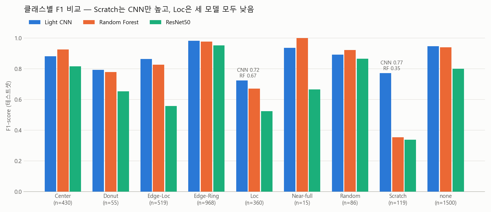

# WM-811K 웨이퍼 결함 분류 모델 비교와 품질 분석

경희대학교 소프트웨어랩(EE370) Term Project입니다. WM-811K 웨이퍼 맵을 정상 패턴을 포함한 9개 유형으로 분류하고, 결함의 위치·밀도·형상을 수치화한 모델 4종과 이미지 기반 CNN 2종의 성능을 비교했습니다. 소프트웨어랩 7강 ML의 분류와 8강 CNN의 합성곱·풀링을 적용했습니다.

> **결과 요약** — 테스트 데이터에서 Light CNN이 Macro F1 0.8663으로 가장 좋았고, 특징 기반 모델 중에서는 Random Forest가 0.8224로 가장 좋았습니다.

| 파일 | 용도 |
| --- | --- |
| [Ram_절약_WM_811K_Wafer_Map.ipynb](Ram_%EC%A0%88%EC%95%BD_WM_811K_Wafer_Map.ipynb) | **재현·제출용.** 전체 실험과 실행 결과가 저장되어 있습니다. 제출 ZIP의 `src/`에 넣는 파일입니다. |
| [머신러닝_WM_811K_Wafer_Map.ipynb](%EB%A8%B8%EC%8B%A0%EB%9F%AC%EB%8B%9D_WM_811K_Wafer_Map.ipynb) | 초기 CNN 학습 기록입니다. 15절 시각화 제목까지만 작성된 중간 기록이므로 재현에는 사용하지 않습니다. |
| [results/](results/) | 6개 모델 비교, 혼동행렬, Edge-Ring 사례, 클래스별 F1 그래프와 지표 CSV |

계획서, 발표자료(14장), 발표 영상과 대본, 실험 보고서는 과목 제출 ZIP(`TP_2023110303_우승지.zip`)에 함께 들어 있습니다.

## 데이터와 실험 설계

[WM-811K 데이터셋](https://www.kaggle.com/datasets/qingyi/wm811k-wafer-map)의 `LSWMD.pkl`을 사용했습니다. 원본 웨이퍼 맵에서 값 0은 웨이퍼 밖, 1은 정상 다이, 2는 불량 다이를 뜻합니다. 라벨이 없는 샘플을 제외하고 정상 클래스(`none`)를 15,000개로 다운샘플링했습니다. 난수 시드 42로 층화 분할한 뒤 학습 32,415장, 검증 4,052장, 테스트 4,052장을 사용했습니다.

- **특징 기반 분류** — 원본 맵에서 전체 결함률, 중심부·외곽부 결함률, 결함의 위치·형상 등을 추출해 Logistic Regression, Decision Tree, Random Forest, Linear SVM을 비교했습니다.
- **이미지 기반 분류** — Light CNN은 최근접 보간으로 변환한 64×64 단일 채널 맵을 입력받습니다. ResNet50은 3채널 입력으로 변환하고 합성곱 기반을 고정한 상태에서 분류기를 학습했습니다. 학습 중에는 웨이퍼 맵을 배치 단위로 읽어 메모리 사용량을 줄였습니다.

제출 ZIP의 `data/`에는 웨이퍼 맵 샘플 1장(`wm811k_sample_row_0.npy`)을 포함합니다. 전체 실험을 재현하려면 위 링크의 LSWMD.pkl이 필요합니다.

## Colab에서 실행하기

실험 환경은 **Google Colab(Linux, Python 3)**입니다. TensorFlow/Keras, NumPy, pandas, scikit-learn, SciPy, joblib, Matplotlib을 사용합니다. GPU는 CNN을 다시 학습할 때 사용할 수 있습니다.

1. 데이터셋에서 `LSWMD.pkl`을 다운로드해 본인 Google Drive의 `내 드라이브/ML Project/WM811K/`에 넣습니다.
2. [Colab에서 재현용 노트북 열기](https://colab.research.google.com/github/WooSeungJi/WM811K-Project/blob/main/Ram_%EC%A0%88%EC%95%BD_WM_811K_Wafer_Map.ipynb)를 누릅니다. 첫 코드 셀에서 Google Drive 연결을 승인합니다. 다른 폴더를 사용할 때는 같은 셀의 `DATA_PATH`와 `OUTPUT_DIR`을 수정합니다. 기본값은 다음과 같습니다.

   ```python
   DATA_PATH = "/content/drive/MyDrive/ML Project/WM811K/LSWMD.pkl"
   OUTPUT_DIR = "/content/drive/MyDrive/ML Project/WM811K/outputs"
   ```

3. **데이터 전처리와 분할 → Light CNN 학습 및 평가 → Feature Engineering과 기준 모델 비교 → ResNet50 학습 및 평가 → 최종 비교와 Edge-Ring 사례** 순서로 셀을 실행합니다. 기존 실행 결과는 GitHub의 노트북에도 남아 있습니다.
4. 실행 후 `outputs/`에서 `light_cnn_result.csv`와 `final_light_cnn.keras`를 확인합니다. `outputs/resnet50_light_experiment/`에는 ResNet50 결과가, `outputs/report_figures/`에는 Edge-Ring 사례의 그림과 수치가 저장됩니다.

원본 노트북에는 패키지 버전이 기록되어 있지 않습니다. 아래 셀을 Colab에서 실행해 확인한 값을 표에 적었습니다(2026-11-27, Colab T4 런타임). Colab은 기본 패키지가 주기적으로 갱신되므로, 다른 시점에 실행하면 버전이 달라질 수 있습니다.

| 항목 | 버전 |
| --- | --- |
| OS | Linux 6.6.159 (x86_64, glibc 2.39) |
| Python | 3.13.16 |
| TensorFlow / Keras | 2.21.0 / 3.13.2 |
| NumPy / pandas | 2.4.6 / 2.2.3 |
| scikit-learn / SciPy | 1.6.1 / 1.16.3 |
| Matplotlib / joblib | 3.10.0 / 1.6.0 |

```python
import platform
from importlib.metadata import version

print("OS:", platform.platform())
print("Python:", platform.python_version())
for package in ("tensorflow", "keras", "numpy", "pandas", "scikit-learn", "scipy", "joblib", "matplotlib"):
    print(package, version(package))
```

## 테스트 결과

아래 수치는 기존 Colab 실험의 테스트 결과입니다. 클래스별 표본 수가 다르므로 전체 정확도와 함께 각 클래스에 같은 비중을 주는 Macro F1을 비교했습니다.

| 모델 | Accuracy | Balanced Accuracy | Macro F1 |
| --- | ---: | ---: | ---: |
| Logistic Regression | 0.8460 | 0.8175 | 0.7613 |
| Decision Tree | 0.8292 | 0.7496 | 0.7505 |
| Random Forest | 0.8959 | 0.8046 | 0.8224 |
| Linear SVM | 0.8549 | 0.7777 | 0.7386 |
| **Light CNN** | **0.9099** | **0.8845** | **0.8663** |
| ResNet50 | 0.7549 | 0.7707 | 0.6867 |

Light CNN의 Macro F1이 0.8663으로 가장 높았고, 특징 기반 모델에서는 Random Forest가 0.8224로 가장 높았습니다.

### 성공 기준 달성 여부

| 계획서의 성공 기준 | 결과 | 판정 |
| --- | --- | :---: |
| Light CNN Macro F1 ≥ 0.85 | 0.8663 | 달성 |
| 특징 기반 최고 모델보다 Macro F1 3%p 이상 높음 | Random Forest 0.8224 대비 +4.39%p | 달성 |
| Light CNN 9개 클래스 재현율 모두 ≥ 0.70 | 최저 Loc 0.7167 | 달성 |
| 혼동이 큰 유형 1쌍 이상 원인 설명 | Loc→Edge-Loc (아래 분석) | 달성 |
| Edge-Ring 사례 외곽부 결함률 ≥ 중심부 × 3 | 20.19% / 3.04% = 6.6배 | 달성 |

### 클래스별 분석



클래스별 정밀도·재현율·F1은 [per_class_metrics.csv](results/per_class_metrics.csv)에 정리했습니다(노트북의 classification_report 출력에서 옮김).

- **Scratch에서 차이가 가장 큼** — 테스트 119장 중 Light CNN은 95장(재현율 0.80)을 맞혔고 Random Forest는 30장(0.25)에 그쳤습니다. 가늘고 긴 선 형태는 결함률·중심 거리 같은 요약 특징에는 잘 드러나지 않지만, 합성곱 필터는 국소적인 선 모양을 직접 학습할 수 있기 때문으로 해석했습니다.
- **Loc은 모든 모델에서 가장 어려움** — F1이 Light CNN 0.72, Random Forest 0.67, ResNet50 0.52였습니다. 혼동행렬에서 Loc을 Edge-Loc으로 예측한 경우가 Light CNN 27건, Random Forest 42건이었습니다. 두 유형은 모두 국소 결함 덩어리이고 위치만 다르기 때문에, 덩어리가 외곽 근처에 있으면 경계가 모호해집니다.
- **Center·Random·Near-full은 Random Forest가 근소하게 높음** — 결함이 중심에 몰리거나 전면에 퍼진 유형은 영역별 결함률 특징만으로도 잘 구분되었습니다. 이미지 모델이 항상 우세한 것은 아니라는 점을 보여 줍니다.
- **ResNet50이 가장 낮았던 이유** — ImageNet 사진으로 학습한 합성곱 층을 고정하고 분류기만 학습했습니다. 마지막 에폭의 학습 정확도도 0.74에 머물러 과소적합으로 판단했습니다. 0·1·2 세 값만 갖는 64×64 맵은 자연 사진과 특성이 달라 사전 학습 특징이 잘 맞지 않았던 것으로 보입니다.

### 한계와 개선 방향

- 테스트셋도 정상 클래스를 15,000장으로 줄인 데이터에서 나눴으므로, 정상이 85% 이상인 실제 분포에서는 정밀도가 달라질 수 있습니다. 원래 분포의 테스트셋을 따로 두어 평가할 필요가 있습니다.
- Near-full(테스트 15장), Donut(55장)은 표본이 적어 F1 값의 변동이 큽니다. 여러 시드로 반복해 평균과 편차를 보고하는 것이 바람직합니다.
- ResNet50은 상위 블록 미세 조정(fine-tuning)과 입력 해상도 확대를 시도하지 않았습니다.
- 품질 점검 항목은 웨이퍼 맵 패턴에서 추정한 것이며, 원인을 확정하려면 공정 이력 데이터가 필요합니다.

Edge-Ring 사례(테스트 샘플 31806)에서 Light CNN과 Random Forest는 모두 Edge-Ring을 예측했습니다. 영역별 결함률은 중심부 3.04%, 외곽부 20.19%로, 외곽에 결함이 집중된 모습을 원본 맵과 결함 마스크에서 함께 확인했습니다. 이 사례에서는 외곽부 공정 균일도와 웨이퍼 이송 조건을 추가 점검 항목으로 제안했습니다.

## 실행 결과 그림

아래 파일은 최종 노트북에 저장된 그림입니다(제출 ZIP의 `results/`와 같습니다).

- [6개 모델 테스트 성능 비교](results/six_model_comparison.png)
- [Light CNN 혼동행렬](results/light_cnn_confusion_matrix.png)
- [Random Forest 혼동행렬](results/random_forest_confusion_matrix.png)
- [Edge-Ring 사례의 원본 맵·결함 마스크·영역 구분](results/edge_ring_case_31806.png)
- [클래스별 F1 비교](results/per_class_f1_comparison.png), [클래스별 지표 CSV](results/per_class_metrics.csv) — 노트북 출력의 classification_report 수치로 제출 전에 따로 그린 그래프입니다.

## 개발 과정과 커밋 이력

Colab에서 저장한 노트북의 코드 변경을 기준으로 주요 작업을 정리했습니다.

- **데이터 탐색** — 초기 노트북에 데이터 로드, 결함 라벨 추출, 클래스 분포 확인 코드 추가. [`cc81f82`](https://github.com/WooSeungJi/WM811K-Project/commit/cc81f82db31382baee5f118d4f4b58ed3919b6d6)
- **메모리 절약형 CNN 실험** — 정상 클래스 다운샘플링과 배치 단위 데이터 로딩을 적용한 Light CNN 노트북 추가. [`d0bd7d0`](https://github.com/WooSeungJi/WM811K-Project/commit/d0bd7d06c2de30245d465b48f1fde76811f5ade6)
- **특징 기반 실험** — 결함의 밀도·위치·형상 특징을 추출하고 Random Forest를 학습·평가하는 코드 추가. [`8b95f59`](https://github.com/WooSeungJi/WM811K-Project/commit/8b95f59290eb9e94d98d39d8e9f73b0e5588b10f)
- **모델 비교 확대** — 특징 기반 모델 4종과 ResNet50 실험을 정리하고 6개 모델의 비교표·그래프 생성 코드 추가. [`80d8007`](https://github.com/WooSeungJi/WM811K-Project/commit/80d8007f8d19155c93a142953cb95ddffdfef141)
- **Edge-Ring 품질 분석** — 저장 모델로 샘플을 예측하고 결함 마스크·영역별 특징을 시각화해 리포트 예시 생성. [`7c19ac5`](https://github.com/WooSeungJi/WM811K-Project/commit/7c19ac504caec118f7890f248a283fb881e12e87)

[전체 커밋 이력 보기](https://github.com/WooSeungJi/WM811K-Project/commits/main/)

## AI 활용 및 검증

| 도구 | 용도 | 검증 방법 |
| --- | --- | --- |
| ChatGPT(Codex) | 계획서·README 초안 정리, 노트북 코드 확인, 저장된 Light CNN의 샘플 추론 확인 | 경로·설정·지표를 노트북 코드와 실행 출력에서 확인하고, 저장된 모델에 별도 샘플 1장을 넣어 상위 3개 예측이 나오는지 확인 |
| Claude | 제출 규정 대비 점검, 계획서 성공 기준 보강, 클래스별 F1 그래프 코드, 발표자료(14장) 생성 스크립트와 발표 대본 초안 작성, README 분석 문단 정리 | 그래프·README의 모든 수치를 노트북의 classification_report와 혼동행렬 출력에 대조(예: Scratch 재현율 0.7983×119 = 95장). 대본은 직접 읽어 보며 발표 시간과 내용을 수정 |

모델 구조, 전처리, 학습 코드는 직접 작성하고 실행했으며 노트북의 각 셀을 설명할 수 있습니다.

## 참고 자료

- 소프트웨어랩 7강 ML, 8강 CNN 강의자료
- [WM-811K Wafer Map 데이터셋](https://www.kaggle.com/datasets/qingyi/wm811k-wafer-map)
- Wu, Jang, Chen, [Wafer Map Failure Pattern Recognition and Similarity Ranking for Large-Scale Data Sets](https://doi.org/10.1109/TSM.2014.2364237), IEEE Transactions on Semiconductor Manufacturing, 2015.
